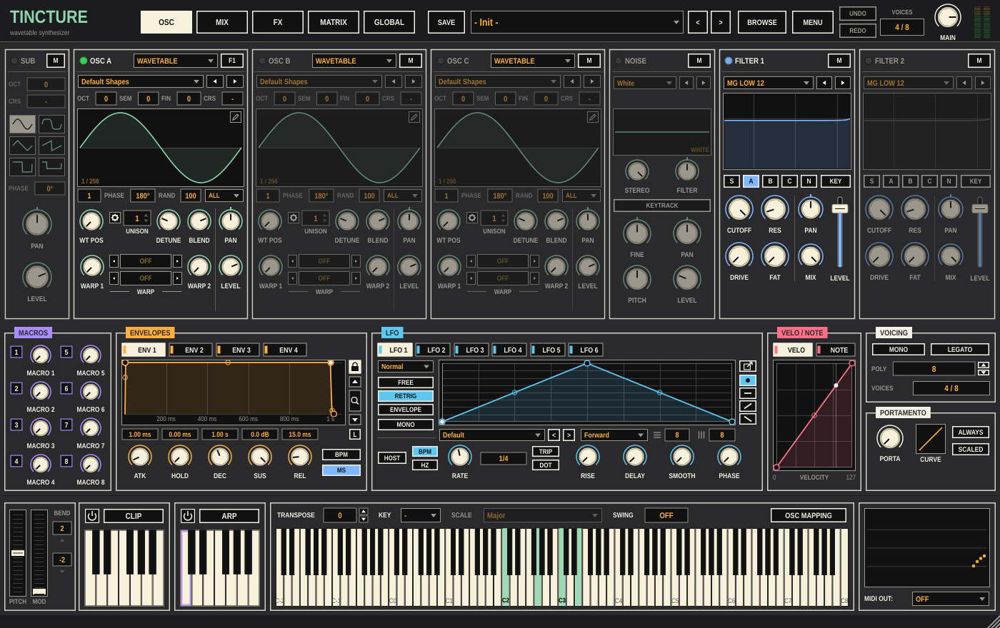

# Tincture

A wavetable synthesizer for Ableton Live, built as one VST3: three
oscillators that can each be a wavetable, multisample, sample, granular or
spectral player, plus a sub and a noise oscillator, two filters with 83
types, a mixer with two buses, three FX racks with 16 module types, 4
envelopes, 10 LFOs, 8 macros, a 64-slot modulation matrix, an arpeggiator, a
MIDI clip player and a wavetable editor.

## Building

You need CMake 3.22+ and a C++20 compiler (Xcode command line tools on macOS).
JUCE 8.0.9 is downloaded on the first configure.

    cmake -B build -DCMAKE_BUILD_TYPE=Release
    cmake --build build --config Release --parallel 8

The plugin is copied to `~/Library/Audio/Plug-Ins/VST3/Tincture.vst3` after
each build. Rescan plug-ins in Live (Preferences > Plug-Ins > Rescan).

To run the tests:

    ctest --test-dir build -C Release

Options: `-DTINCTURE_JUCE_DIR=/path/to/JUCE` to use a local JUCE,
`-DTINCTURE_ENGINE_ONLY=ON` to build only the sound engine and its tests (no
JUCE, fast), `-DTINCTURE_BUILD_TOOLS=ON` for the dev tools below.

## Layout

- `Source/Engine` — the sound engine. No JUCE; plain C++20. Voices and routing
  (`Synth`), oscillators (`WavetableOsc`, `SampleOsc`, `SubOsc`, `NoiseOsc`,
  `Warp`), `Filters`, `Fx/` (racks and the 16 modules), modulation
  (`Envelope`, `Lfo`, `ModMatrix`), `Arp`, `Clip`, `NoteProcessor`, `Scales`,
  the wavetable editor's operations (`WaveEdit`, `Formula`, `WaveImport`), and
  the parameter registry (`Params`, `ParamIds`).
- `Source/Model` — the patch (everything that isn't a parameter), its state
  tree, and the factory presets (`FactorySounds.cpp`).
- `Source/UI` — the panel. `Menu.h` is the menu system every dropdown and
  context menu uses (drawn inside the panel, never as OS windows); `Bind.h`
  has the parameter-bound controls; one file per page.
- `Source/PluginProcessor.*`, `PluginEditor.*` — the plugin itself: host
  parameters, undo history, presets, MIDI learn, locks; the header and pages.
- `Tests/` — one program per engine area, plus `MenuTests.cpp`.
- `Tools/` — `Bench.cpp` (CPU cost of whole patches) and the snapshot tool
  (`Snapshot.cpp` + `Shots*.cpp`), which runs the plugin without a host,
  renders the panel to PNGs and drives every page's menus with simulated
  mouse input:

      cmake -B build -DTINCTURE_BUILD_TOOLS=ON && cmake --build build --target TinctureSnapshot
      ./build/TinctureSnapshot_artefacts/Release/TinctureSnapshot out shot all

## Where things are saved

`~/Library/Application Support/Tincture/`: settings, `Presets/` (`.tincture`
files), `Tables/`, `Samples/`, `LFO Shapes/`, `Banks/` (arp, clip and FX
rack presets), and `Default.tincture` (MENU > Save as Default Preset).

## CPU

Measured with `TinctureBench`, 48 kHz, 512-sample blocks, one x86 core:

| Patch | CPU |
| --- | --- |
| Init, 8 notes | 1.7 % |
| 3 oscillators x 7 unison, 2 filters, 8 notes | 6.5 % |
| the same with warps, sub, noise, a 6-module FX rack and modulation | 9.4 % |
| 16 notes, 3 oscillators x 16 unison | 10.0 % |

## Not done yet

- Factory sample content: there are no multisample instruments or tonal
  sample libraries; load your own audio (WAV, AIFF, FLAC) into the sample,
  granular and spectral modes or a folder of samples as a multisample.
- MPE and note expression, tuning files and MTS-ESP, the voice sequence
  panel on GLOBAL, and a few preferences (shown disabled on GLOBAL).
- Clip and arp automation lanes (other than velocity), Render OSC Warp,
  Resample to, preset packs, Hybridize in the browser.
- FX parameters are exposed to the host as generic "FX n Pn" slots; the
  panel names them after the module using them.

## Licence

See LICENSE.
